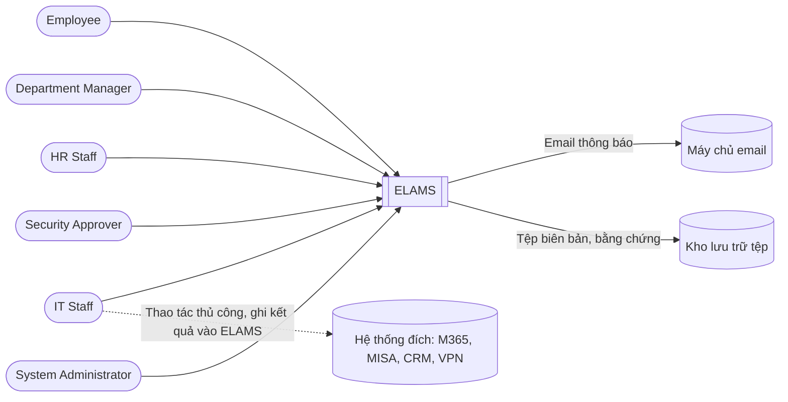
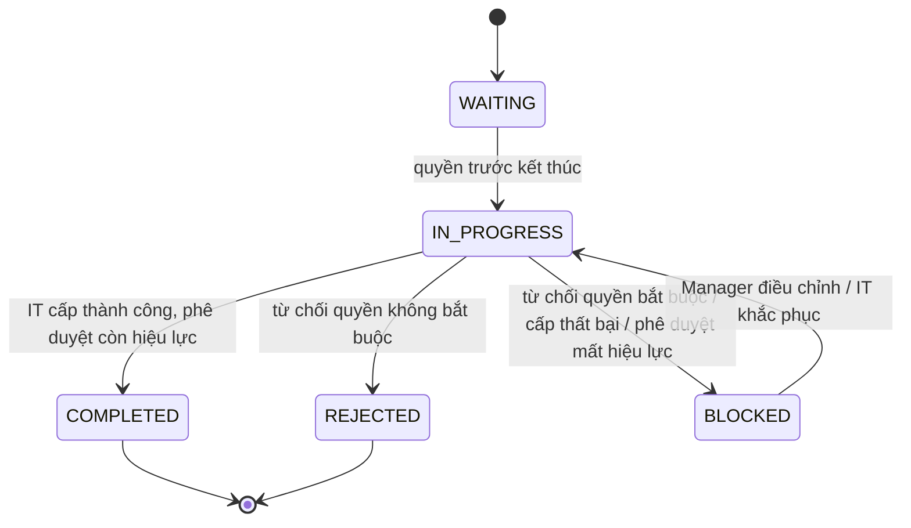
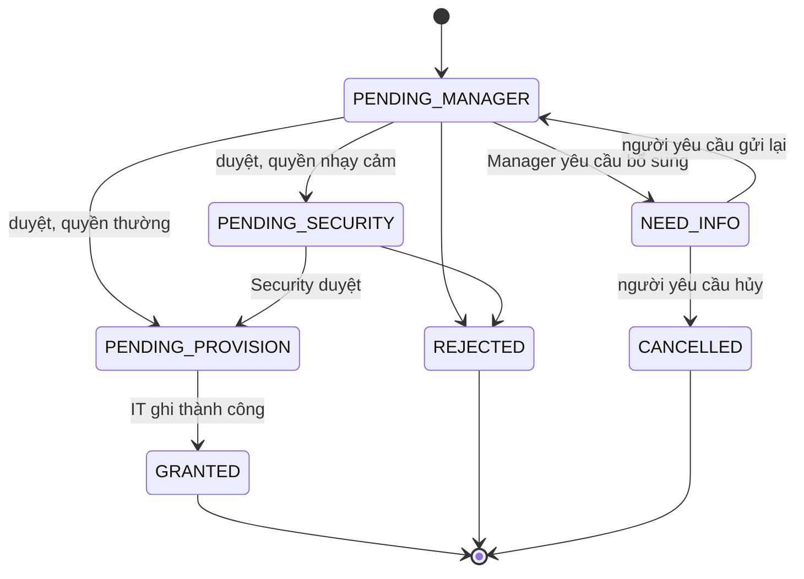
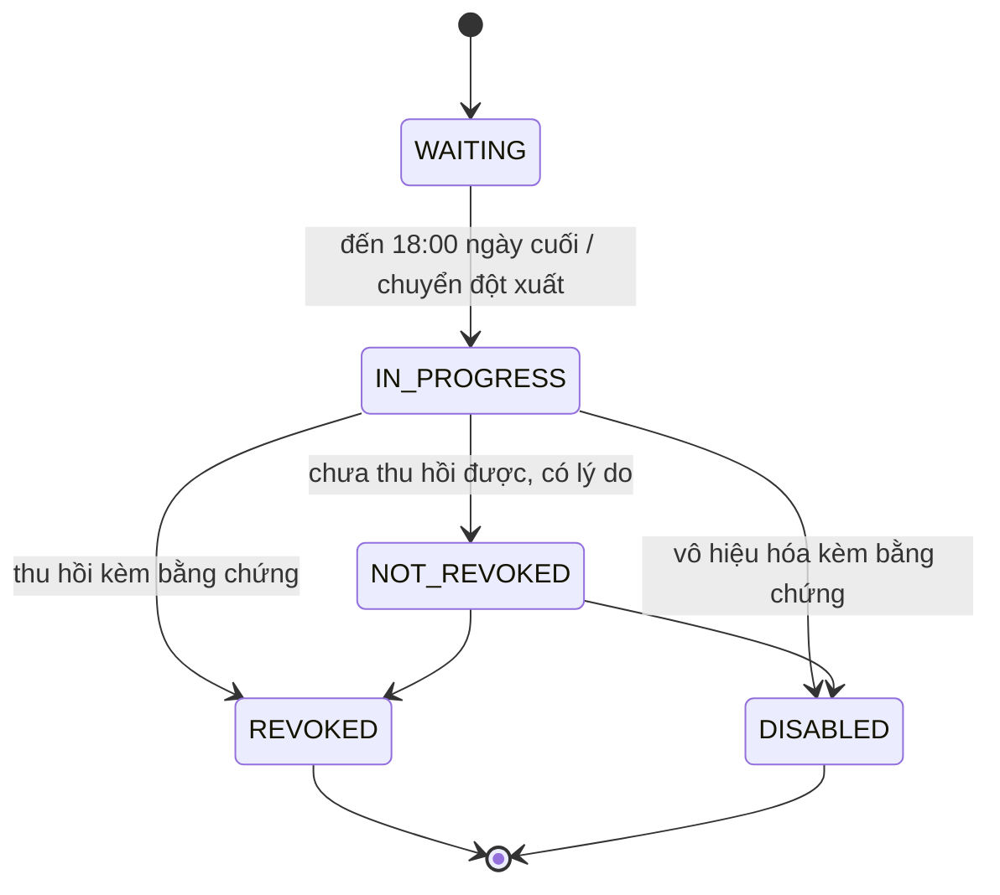
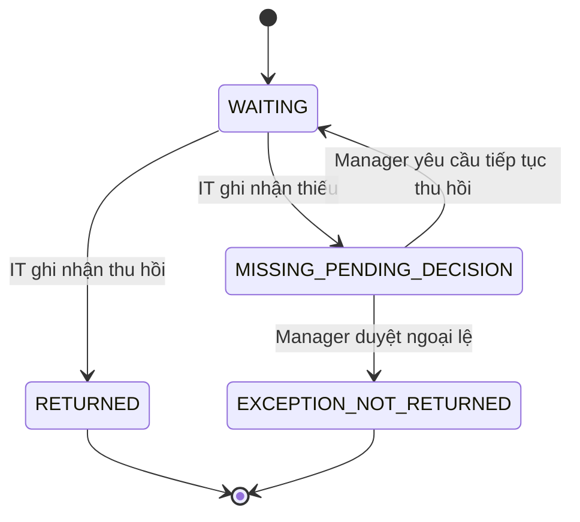

# ĐẶC TẢ YÊU CẦU PHẦN MỀM (SRS) – ELAMS

**Dự án:** Employee Lifecycle & Access Management System (ELAMS)

**Doanh nghiệp:** TechNova (Giả định)

**Phiên bản:** 0.1 – Bản nháp

**Ngày tạo:** 26/11/2026

**Người thực hiện:** Business Analyst

**Trạng thái:** Chờ review – Chưa được xác nhận bởi stakeholder thực tế

---

## 1. Giới thiệu

### 1.1. Mục đích

Tài liệu mô tả ELAMS **phải làm gì** ở mức hệ thống: chức năng, phân quyền, trạng thái dữ liệu, yêu cầu phi chức năng và giao tiếp bên ngoài. Đây là đầu vào cho thiết kế và kiểm thử. Lý do nghiệp vụ nằm ở các BRD; chi tiết tương tác nằm ở use case, user story và đặc tả màn hình.

### 1.2. Phạm vi

**Trong phạm vi (phát hành 1):** ba quy trình Onboarding, Access Request, Offboarding và các chức năng dùng chung (việc cần làm, thông báo, cảnh báo quá hạn, lịch sử thao tác, quản trị danh mục).

**Ngoài phạm vi:**

- Tích hợp tự động với hệ thống đích (Microsoft 365, MISA, CRM…): IT thao tác trên hệ thống đích và ghi kết quả vào ELAMS.
- Dashboard KPI, xuất báo cáo (BREQ-ON-13, F-12, F-15), ủy quyền phê duyệt, escalation tự động, quyền tạm thời.
- Hủy onboarding hoặc offboarding, thu hồi quyền lẻ ngoài offboarding.
- Ứng dụng di động.

### 1.3. Thuật ngữ

| Thuật ngữ | Nghĩa |
| --- | --- |
| Hệ thống đích | Hệ thống nội bộ mà nhân viên cần quyền truy cập (Microsoft 365, MISA, CRM, VPN…) |
| Quyền | Một mục trong danh mục quyền, thuộc một hệ thống đích, có các mức (Xem, Ghi, Quản trị) và cờ nhạy cảm |
| Tài khoản | Định danh của nhân viên trên một hệ thống đích; mỗi nhân viên một tài khoản mỗi hệ thống |
| Sổ quyền | Danh sách mọi quyền nhân viên đang có (bảng `access_grant`) |
| Nhiệm vụ | Việc giao cho một người, có hạn và trạng thái, hiển thị ở Việc cần làm |
| COMPLETED / REJECTED / BLOCKED | Trạng thái của một quyền trong yêu cầu onboarding (BR-ON-02) |
| Đột xuất | Offboarding phải thu hồi quyền ngay, không chờ ngày nghỉ việc |

### 1.4. Tài liệu tham chiếu

| Loại | Tài liệu |
| --- | --- |
| BRD | [Onboarding](../brd/brd-onboarding.md) · [Access Request](../brd/brd-access-request.md) · [Offboarding](../brd/brd-offboarding.md) |
| Quy tắc | [Business Rules Catalog](../business-rules/business-rules-catalog.md) |
| Use case | [Onboarding](../use-case-specifications/onboarding-use-cases.md) · [Access Request](../use-case-specifications/access-request-use-cases.md) · [Offboarding](../use-case-specifications/offboarding-use-cases.md) |
| User story | [Onboarding](../user-stories/onboarding-user-stories.md) · [Access Request](../user-stories/access-request-user-stories.md) · [Offboarding](../user-stories/offboarding-user-stories.md) |
| Màn hình | [Onboarding](../../06-ui-ux/onboarding-screen-specifications.md) · [Access Request](../../06-ui-ux/access-request-screen-specifications.md) · [Offboarding](../../06-ui-ux/offboarding-screen-specifications.md) |
| Dữ liệu | [ERD](../../04-data-models/elams-erd.drawio) · [Từ điển dữ liệu](../../04-data-models/data-dictionary.md) |

### 1.5. Quy ước

- Mã yêu cầu: `FR-GEN` dùng chung, `FR-ON` Onboarding, `FR-AC` Access Request, `FR-OFF` Offboarding, `NFR` phi chức năng.
- "Hệ thống phải" là bắt buộc. Ưu tiên theo MoSCoW, kế thừa từ BREQ nguồn.
- Cột **Nguồn** ghi use case (UC) và user story (US); acceptance criteria chi tiết nằm ở user story.

## 2. Mô tả tổng quan

### 2.1. Bối cảnh hệ thống

ELAMS không gọi trực tiếp hệ thống đích. Đường nét đứt thể hiện IT thao tác ngoài ELAMS rồi ghi kết quả và bằng chứng vào ELAMS.

### 2.2. Vai trò người dùng

| Vai trò | Mô tả | Ước lượng số người dùng |
| --- | --- | --- |
| EMPLOYEE | Mọi nhân viên có tài khoản; gửi yêu cầu quyền, cập nhật bàn giao khi nghỉ việc | ~500 |
| MANAGER | Trưởng phòng; duyệt quyền, lập và xác nhận bàn giao, duyệt ngoại lệ thiết bị | ~30 |
| HR | Tạo và đóng onboarding, offboarding | ~5 |
| IT | Cấp, thu hồi quyền và thiết bị | ~8 |
| SECURITY | Duyệt quyền nhạy cảm, xem lịch sử, nhận cảnh báo thu hồi trễ | ~2 |
| ADMIN | Quản trị danh mục, người dùng; xem lịch sử | ~2 |

Mỗi người dùng có một vai trò chính; mọi vai trò đều có quyền của EMPLOYEE với dữ liệu của chính mình.

### 2.3. Ràng buộc và giả định

- Ứng dụng web cho máy tính, giao diện tiếng Việt, một doanh nghiệp, giờ Việt Nam (UTC+7).
- Dữ liệu cơ cấu tổ chức, danh mục quyền, tài sản thiết bị và người dùng được Admin nhập trước khi vận hành.
- Các giả định nghiệp vụ theo [Open Questions Log](../../01-discovery/open-questions-log.md) (các câu trạng thái "Có giả định").

## 3. Ma trận phân quyền

Phạm vi: **Mình** = dữ liệu của chính người dùng; **Phòng** = nhân viên mình quản lý trực tiếp; **Giao** = đối tượng có nhiệm vụ giao cho người dùng; **Tất cả** = toàn bộ.

| Chức năng | EMPLOYEE | MANAGER | HR | IT | SECURITY | ADMIN |
| --- | --- | --- | --- | --- | --- | --- |
| Việc cần làm | Mình | Mình | Mình | Mình | Mình | – |
| Tạo, đổi ngày, xác nhận hoàn tất onboarding | – | – | Tất cả | – | – | – |
| Xem yêu cầu onboarding | – | Phòng | Tất cả | Giao | Giao | Tất cả |
| Duyệt nhu cầu quyền, điều chỉnh quyền bị chặn | – | Phòng | – | – | – | – |
| Duyệt quyền nhạy cảm | – | – | – | – | Giao | – |
| Cấp quyền, bàn giao thiết bị | – | – | – | Giao | – | – |
| Gửi, bổ sung, hủy yêu cầu quyền | Mình | Mình | Mình | Mình | Mình | Mình |
| Xem yêu cầu quyền | Mình | Mình + Phòng | – | Giao | Giao | Tất cả |
| Duyệt yêu cầu quyền | – | Phòng (không phải của mình) | – | – | Giao | – |
| Tạo, đổi ngày, chuyển đột xuất, xác nhận offboarding | – | – | Tất cả | – | – | – |
| Xem yêu cầu offboarding | – | Phòng | Tất cả | Giao | Giao | Tất cả |
| Lập, xác nhận bàn giao; duyệt ngoại lệ thiết bị | – | Phòng | – | – | – | – |
| Cập nhật tiến độ bàn giao | Mình | Phòng (cập nhật thay) | – | – | – | – |
| Thu hồi quyền, thu hồi thiết bị | – | – | – | Giao | – | – |
| Xem lịch sử thao tác | – | – | – | – | Tất cả | Tất cả |
| Quản trị danh mục, người dùng | – | – | – | – | – | Tất cả |

Phạm vi "Phòng" của Manager và "Giao" của IT, Security là giả định (Q-33). Quyền xem lịch sử là giả định (Q-30).

## 4. Yêu cầu chức năng

### 4.1. Dùng chung

| Mã | Yêu cầu | Nguồn | Quy tắc | Ưu tiên |
| --- | --- | --- | --- | --- |
| FR-GEN-01 | Hệ thống phải yêu cầu đăng nhập; tài khoản DISABLED không đăng nhập được. | F-10 | – | Must |
| FR-GEN-02 | Hệ thống phải giới hạn chức năng và dữ liệu theo ma trận mục 3, kiểm tra ở mọi thao tác. Truy cập ngoài phạm vi trả thông báo không có quyền và được ghi lịch sử. | F-10; US-ON-04, US-AC-09, US-OFF-12 | – | Must |
| FR-GEN-03 | Hệ thống phải hiển thị Việc cần làm của người dùng: nhiệm vụ chưa kết thúc, sắp xếp quá hạn trước rồi theo hạn tăng dần, lọc theo loại; nhiệm vụ của yêu cầu đột xuất đứng đầu. | UC-ON-02; US-ON-04 | BR-GEN-01 | Must |
| FR-GEN-04 | Hệ thống phải tạo mọi nhiệm vụ với người phụ trách, hạn và trạng thái. Nhiệm vụ chờ người yêu cầu bổ sung thông tin không có hạn. | US-ON-02 | BR-GEN-01 | Must |
| FR-GEN-05 | Hệ thống phải gửi thông báo trong ứng dụng và email khi: có nhiệm vụ mới; yêu cầu của người dùng đổi trạng thái kết thúc hoặc cần bổ sung; quyết định từ chối hoặc ngoại lệ được ghi nhận. | UC-AC-03 | BR-GEN-02 | Must |
| FR-GEN-06 | Hệ thống phải đánh dấu Quá hạn và cảnh báo người phụ trách cùng người theo dõi (HR với onboarding, offboarding) khi: quá hạn hiện hành, nhiệm vụ chưa kết thúc, chưa cảnh báo cho hạn này. Hạn thay đổi thì gỡ dấu và tính lại. | UC-ON-10, UC-AC-07, UC-OFF-10; US-ON-15, US-AC-10, US-OFF-13 | BR-GEN-01 | Should |
| FR-GEN-07 | Hệ thống phải nhắc người phụ trách khi nhiệm vụ sắp đến hạn; ngưỡng cấu hình được (Q-01). | UC-ON-10 AF-01 | BR-GEN-01 | Should |
| FR-GEN-08 | Hệ thống phải bắt buộc nhập lý do cho quyết định từ chối, yêu cầu bổ sung, duyệt ngoại lệ, đánh dấu chưa đạt, chuyển đột xuất; thiếu lý do thì không lưu. | US-ON-05, US-AC-04, US-OFF-09 | BR-GEN-02 | Must |
| FR-GEN-09 | Hệ thống phải ghi lịch sử cho: tạo yêu cầu, mọi quyết định, cập nhật trạng thái, cấp và thu hồi quyền, cấp và thu hồi thiết bị, xác nhận hoàn tất, thao tác quản trị, lần gửi cảnh báo, truy cập trái phép. Mỗi bản ghi gồm người thực hiện, thao tác, đối tượng, kết quả, lý do, thời điểm. | US-ON-13 | BR-GEN-03 | Must |
| FR-GEN-10 | Hệ thống không được cung cấp chức năng sửa hoặc xóa lịch sử thao tác. Security và Admin xem, lọc lịch sử theo yêu cầu, người thực hiện, loại thao tác, khoảng thời gian. | UC-ON-09; US-ON-13 | BR-GEN-03 | Must |
| FR-GEN-11 | Hệ thống phải cho Admin quản trị: phòng ban, chức danh, Manager trực tiếp của nhân viên, hệ thống đích, danh mục quyền (mức, cờ nhạy cảm), mẫu quyền và thiết bị theo chức danh, tài sản thiết bị, người dùng và vai trò. Ngừng sử dụng thay vì xóa mục đã được tham chiếu. | Q-07, Q-17 | BR-AC-03 | Must |
| FR-GEN-12 | Hệ thống phải cấp mã yêu cầu duy nhất theo dạng ONB-, AR-, OFF- kèm năm và số thứ tự (ví dụ ONB-2026-0012). | – | – | Must |
| FR-GEN-13 | Hệ thống phải nhận tệp đính kèm PDF, JPG, PNG tối đa 10 MB và cho người có quyền xem tải về. | SCR-ON-05, SCR-OFF-04 | – | Must |
| FR-GEN-14 | Hệ thống phải giữ sổ quyền: tạo một dòng khi quyền được cấp (onboarding COMPLETED, yêu cầu quyền Đã cấp); cập nhật khi quyền bị thu hồi hoặc tạm ngừng. | BR-OFF-02 | BR-OFF-02, BR-AC-07 | Must |
| FR-GEN-15 | Hệ thống phải bảo đảm mỗi nhân viên có tối đa một tài khoản trên mỗi hệ thống đích; khi cấp quyền, hiển thị và chọn sẵn tài khoản đã ghi nhận. Áp dụng cho cả Onboarding và Access Request. | US-ON-08, US-AC-07 | BR-ON-10 | Must |

### 4.2. Onboarding

| Mã | Yêu cầu | Nguồn | Quy tắc | Ưu tiên |
| --- | --- | --- | --- | --- |
| FR-ON-01 | Hệ thống phải cho HR tạo yêu cầu với dữ liệu tại BRD Onboarding 9.1 và tạo hồ sơ nhân viên trạng thái PRE_HIRE. | UC-ON-01; US-ON-01 | – | Must |
| FR-ON-02 | Hệ thống phải tải mẫu quyền và thiết bị theo chức danh. Quyền bắt buộc theo mẫu không đổi được phân loại và không xóa được; quyền thêm thủ công phải chọn phân loại. | UC-ON-01; US-ON-01 AC-1, AC-5 | BR-ON-01 | Must |
| FR-ON-03 | Hệ thống phải kiểm tra trường bắt buộc và ngày bắt đầu không trước ngày tạo; dữ liệu lỗi không tạo yêu cầu. | US-ON-01 AC-2, AC-3 | – | Must |
| FR-ON-04 | Hệ thống phải từ chối tạo yêu cầu khi nhân viên (nhận diện bằng email cá nhân, Q-38) đã có yêu cầu chưa hoàn tất, và chỉ ra yêu cầu hiện có. | US-ON-01 AC-4 | BR-ON-11 | Must |
| FR-ON-05 | Hệ thống phải lưu yêu cầu và tạo đủ nhiệm vụ bắt buộc như một thao tác trọn gói; thất bại thì không lưu gì và giữ dữ liệu trên biểu mẫu. Gửi lại không tạo trùng. | UC-ON-01 EF-02; US-ON-02 | BQ-ON-01 | Must |
| FR-ON-06 | Hệ thống phải xử lý các quyền lần lượt theo thứ tự; quyền sau bắt đầu khi quyền trước COMPLETED hoặc REJECTED. | US-ON-02 AC-2, US-ON-06 AC-2 | BR-ON-09 | Must |
| FR-ON-07 | Hệ thống phải giao nhiệm vụ xét duyệt cho Manager; khi Manager phê duyệt, chuyển quyền nhạy cảm cho Security, quyền khác cho IT. | UC-ON-03; US-ON-05 AC-1, AC-2 | BR-AC-03 | Must |
| FR-ON-08 | Khi bị từ chối, hệ thống phải kết thúc quyền không bắt buộc với REJECTED; chuyển quyền bắt buộc sang BLOCKED và tạo nhiệm vụ điều chỉnh cho Manager. | US-ON-05 AC-3, AC-5; US-ON-07 AC-3 | BR-ON-01, BR-ON-02 | Must |
| FR-ON-09 | Hệ thống phải cho Manager điều chỉnh mức của quyền BLOCKED (không đổi phân loại) và đưa quyền quay lại bước xét duyệt của Manager. | UC-ON-03 AF-03; US-ON-06 | BR-ON-01 | Must |
| FR-ON-10 | Hệ thống phải chỉ tạo nhiệm vụ cấp quyền khi quyền đã đủ mọi phê duyệt bắt buộc. | US-ON-07 AC-4, US-ON-08 AC-4 | BR-AC-04 | Must |
| FR-ON-11 | Hệ thống phải cho IT ghi kết quả cấp quyền: thành công kèm tài khoản và bằng chứng → COMPLETED; thất bại hoặc không xác định tài khoản kèm lý do → BLOCKED; không cho tạo tài khoản mới khi chưa xác định. | UC-ON-05; US-ON-08, US-ON-09 AC-1 → AC-3 | BR-ON-02, BR-ON-10 | Must |
| FR-ON-12 | Trước khi chuyển COMPLETED, hệ thống phải kiểm tra phê duyệt còn hiệu lực. Không còn hiệu lực: quyền BLOCKED, IT nhận yêu cầu thu hồi hoặc tạm ngừng kèm bằng chứng; chỉ cấp lại khi có phê duyệt hợp lệ mới. | UC-ON-05 EF-03; US-ON-09 AC-4, AC-5 | BR-ON-12 | Must |
| FR-ON-13 | Hệ thống phải cho IT ghi nhận thiếu thiết bị kèm lý do; nhiệm vụ giữ trạng thái chờ cho tới khi IT xác nhận có thiết bị. | UC-ON-06 AF-01; US-ON-11 | BR-ON-03 | Must |
| FR-ON-14 | Hệ thống phải yêu cầu đủ mã thiết bị, thời gian, tình trạng, mã biên bản và tệp biên bản trước khi hoàn thành bàn giao; khi hoàn thành, thiết bị chuyển ASSIGNED cho nhân viên. | UC-ON-06; US-ON-10 | BR-GEN-03 | Must |
| FR-ON-15 | Hệ thống phải kiểm tra điều kiện hoàn tất khi các nhánh kết thúc hoặc khi dữ liệu liên quan thay đổi; không kiểm tra lại khi chỉ xem. Chưa đạt thì hiển thị điều kiện thiếu và người đang giữ. | UC-ON-07; US-ON-12 AC-1, AC-3, AC-4 | BR-ON-06, BR-ON-07 | Must |
| FR-ON-16 | Khi HR xác nhận, hệ thống phải kiểm tra lại điều kiện ngay trước khi ghi; điều kiện đổi thì quay về chờ và báo lý do; lỗi ghi thì giữ nguyên trạng thái và không báo thành công. | UC-ON-07; US-ON-12 AC-2, AC-5 | BR-ON-08, BQ-ON-02 | Must |
| FR-ON-17 | Khi onboarding Hoàn tất, hệ thống phải chuyển nhân viên sang ACTIVE và tạo tài khoản ELAMS vai trò EMPLOYEE (giả định Q-47). | – | – | Must |
| FR-ON-18 | Hệ thống phải cho HR đổi ngày bắt đầu kèm lý do; tính lại hạn nhiệm vụ chưa xong; không cấp lại hay thu hồi quyền; chưa cập nhật xong thì không chuyển Chờ HR xác nhận. | UC-ON-08; US-ON-14 | BR-ON-04, BR-ON-05 | Should |

### 4.3. Access Request

| Mã | Yêu cầu | Nguồn | Quy tắc | Ưu tiên |
| --- | --- | --- | --- | --- |
| FR-AC-01 | Hệ thống phải cho nhân viên gửi yêu cầu một quyền cho chính mình với quyền, mức, lý do bắt buộc; hiển thị hệ thống đích, cờ nhạy cảm và cấp phê duyệt dự kiến khi chọn quyền. | UC-AC-01; US-AC-01 AC-1 → AC-3 | BR-AC-01, BR-AC-03 | Must |
| FR-AC-02 | Hệ thống phải xác định người duyệt là Manager trực tiếp; nếu người yêu cầu là Manager thì là cấp trên trực tiếp; không xác định được thì không tạo yêu cầu. | UC-AC-01 AF-01, EF-03; US-AC-01 AC-6, US-AC-02 | BR-AC-06 | Must |
| FR-AC-03 | Hệ thống phải từ chối yêu cầu trùng quyền còn chưa kết thúc; cảnh báo khi người yêu cầu đã có quyền trong sổ quyền nhưng vẫn cho gửi sau khi xác nhận. | US-AC-01 AC-4, AC-5 | BR-AC-07 | Must |
| FR-AC-04 | Hệ thống phải cho người duyệt chọn Phê duyệt, Yêu cầu bổ sung hoặc Từ chối, kèm thông tin quyền hiện có của người yêu cầu trên hệ thống đó. | UC-AC-04; US-AC-03, US-AC-04 | BR-AC-02 | Must |
| FR-AC-05 | Hệ thống không được giao nhiệm vụ duyệt cho chính người yêu cầu. | US-AC-02 | BR-AC-06 | Must |
| FR-AC-06 | Ở trạng thái Chờ bổ sung, hệ thống phải cho người yêu cầu sửa mức, lý do, tệp (không đổi quyền) và gửi lại với cùng mã; hoặc hủy. Yêu cầu không tự hủy theo thời gian. | UC-AC-02; US-AC-05 | BR-AC-02, BQ-AC-01 | Must |
| FR-AC-07 | Hệ thống phải chuyển yêu cầu quyền nhạy cảm đã được Manager duyệt cho Security; Security chỉ có Phê duyệt hoặc Từ chối. | UC-AC-05; US-AC-06 | BR-AC-03 | Must |
| FR-AC-08 | Hệ thống phải chỉ tạo nhiệm vụ cấp quyền cho IT khi yêu cầu đủ phê duyệt. | US-AC-03 AC-3, US-AC-06 AC-2 | BR-AC-04 | Must |
| FR-AC-09 | Hệ thống phải chỉ chuyển yêu cầu sang Đã cấp khi IT ghi thành công kèm tài khoản và bằng chứng; thất bại hoặc không xác định tài khoản giữ Chờ cấp quyền. Khi Đã cấp, ghi sổ quyền và thông báo người yêu cầu. | UC-AC-06; US-AC-07, US-AC-08 | BR-AC-05, BQ-AC-02 | Must |
| FR-AC-10 | Hệ thống phải cho nhân viên xem danh sách và tiến trình yêu cầu của mình; Manager xem thêm yêu cầu của nhân viên mình quản lý. Người yêu cầu không thấy chi tiết lỗi cấp quyền của IT. | UC-AC-03; US-AC-09 | BR-GEN-01 | Must |

### 4.4. Offboarding

| Mã | Yêu cầu | Nguồn | Quy tắc | Ưu tiên |
| --- | --- | --- | --- | --- |
| FR-OFF-01 | Hệ thống phải cho HR tạo yêu cầu với nhân viên, ngày làm việc cuối cùng, lý do, cờ đột xuất; chuyển nhân viên sang OFFBOARDING. Nhân viên đã có yêu cầu chưa hoàn tất thì không tạo. | UC-OFF-01; US-OFF-01 | BR-OFF-01 | Must |
| FR-OFF-02 | Khi ngày làm việc cuối cùng đã qua, hệ thống phải cảnh báo và đề xuất đánh dấu đột xuất. | UC-OFF-01 EF-03; US-OFF-01 AC-5 | BR-OFF-03 | Must |
| FR-OFF-03 | Hệ thống phải lập danh sách thu hồi từ sổ quyền đang hiệu lực và thiết bị đang cấp của nhân viên; tạo nhiệm vụ bàn giao cho Manager, thu hồi quyền và thu hồi thiết bị cho IT. | UC-OFF-01; US-OFF-01 AC-1, AC-3 | BR-OFF-02 | Must |
| FR-OFF-04 | Hệ thống phải đặt thời điểm thu hồi là 18:00 ngày làm việc cuối cùng; với yêu cầu đột xuất là ngay khi tạo, hạn 4 giờ. Nhiệm vụ thu hồi quyền ở trạng thái chờ và tự kích hoạt đúng thời điểm. | UC-OFF-05; US-OFF-02 AC-1, US-OFF-06 AC-1, AC-2 | BR-OFF-03 | Must |
| FR-OFF-05 | Hệ thống phải cho HR chuyển yêu cầu sang đột xuất kèm lý do khi thu hồi chưa bắt đầu; thu hồi bắt đầu ngay, hạn 4 giờ, thông báo IT và Manager. | UC-OFF-09 AF-01; US-OFF-02 AC-2, AC-3 | BR-OFF-04 | Must |
| FR-OFF-06 | Hệ thống phải cho IT ghi kết quả từng mục thu hồi: Đã thu hồi hoặc Đã vô hiệu hóa kèm bằng chứng; Chưa thu hồi được kèm lý do. Không có lựa chọn đóng theo ngoại lệ. Thu hồi thành công cập nhật sổ quyền và tài khoản. | UC-OFF-05; US-OFF-06 AC-3, AC-4, US-OFF-07 AC-1 | BR-OFF-05 | Must |
| FR-OFF-07 | Hệ thống phải cho IT bổ sung mục thu hồi cho quyền cấp ngoài ELAMS (hệ thống, tài khoản). | UC-OFF-05 AF-02; US-OFF-07 AC-3 | BR-OFF-02 | Must |
| FR-OFF-08 | Hệ thống phải chỉ kết thúc nhánh thu hồi quyền khi mọi mục là Đã thu hồi hoặc Đã vô hiệu hóa. | US-OFF-06 AC-5, US-OFF-07 AC-2 | BR-OFF-05 | Must |
| FR-OFF-09 | Hệ thống phải cho Manager lập kế hoạch bàn giao (hạng mục, người nhận, hạn), đánh dấu hạng mục chưa đạt kèm lý do, và xác nhận bàn giao đầy đủ khi mọi hạng mục đã bàn giao. | UC-OFF-03; US-OFF-03, US-OFF-05 | BR-OFF-08 | Must |
| FR-OFF-10 | Hệ thống phải cho nhân viên nghỉ việc cập nhật tiến độ bàn giao của mình và không cho họ thấy nhiệm vụ thu hồi. Khi yêu cầu đột xuất hoặc tài khoản nhân viên đã bị thu hồi, Manager được cập nhật thay; lịch sử ghi người cập nhật thay. | UC-OFF-04; US-OFF-04 | BR-GEN-03 | Must |
| FR-OFF-11 | Hệ thống phải cho IT ghi nhận thu hồi thiết bị (thời điểm, tình trạng) – thiết bị về kho – hoặc ghi nhận thiếu (lý do, bằng chứng) – tạo nhiệm vụ quyết định cho Manager. | UC-OFF-06; US-OFF-08, US-OFF-09 AC-1 | BR-OFF-06 | Must |
| FR-OFF-12 | Hệ thống phải cho Manager duyệt ngoại lệ (kèm lý do) – thiết bị chuyển Ngoại lệ – chưa thu hồi, vẫn được theo dõi, HR được thông báo – hoặc yêu cầu tiếp tục thu hồi. | UC-OFF-07; US-OFF-09 AC-2 → AC-5 | BR-OFF-06 | Must |
| FR-OFF-13 | Hệ thống phải kiểm tra điều kiện hoàn tất (quyền thu hồi đủ, bàn giao xác nhận, thiết bị thu hồi hoặc ngoại lệ) và cho HR xác nhận như FR-ON-15, FR-ON-16. Khi Hoàn tất, nhân viên chuyển LEFT và tài khoản ELAMS bị vô hiệu hóa. | UC-OFF-08; US-OFF-10 | BR-OFF-08, BQ-OFF-01 | Must |
| FR-OFF-14 | Hệ thống phải gửi cảnh báo thu hồi quyền quá hạn cho IT, HR và Security. | UC-OFF-10; US-OFF-13 AC-2 | BR-OFF-05 | Should |
| FR-OFF-15 | Hệ thống phải cho HR đổi ngày nghỉ việc kèm lý do: tính lại hạn nhiệm vụ chưa xong và thời điểm thu hồi; không mở lại việc đã xong, không cấp lại quyền đã thu hồi; ngày đã qua thì không lưu và đề xuất chuyển đột xuất. | UC-OFF-09; US-OFF-11 | BR-OFF-07 | Should |

## 5. Mô hình trạng thái

Chuyển trạng thái chỉ xảy ra theo các mũi tên dưới đây; mọi chuyển trạng thái được ghi lịch sử (FR-GEN-09).

### 5.1. Quyền trong yêu cầu onboarding (`onboarding_access_item`)

### 5.2. Yêu cầu cấp quyền (`access_request`)

### 5.3. Mục thu hồi quyền (`revocation_item`)

Không có trạng thái ngoại lệ (BR-OFF-05).

### 5.4. Mục thu hồi thiết bị (`device_return_item`)

### 5.5. Yêu cầu onboarding và offboarding

Cả hai dùng chung: IN_PROGRESS → PENDING_CONDITIONS hoặc PENDING_HR_CONFIRMATION (sau khi kiểm tra điều kiện) → COMPLETED (sau khi HR xác nhận). PENDING_CONDITIONS chỉ được kiểm tra lại khi có dữ liệu liên quan mới (BR-ON-07); PENDING_HR_CONFIRMATION quay về PENDING_CONDITIONS nếu điều kiện thay đổi ngay trước khi ghi (BR-ON-08).

## 6. Yêu cầu dữ liệu

Mô hình dữ liệu, kiểu, ràng buộc và giá trị liệt kê: [Từ điển dữ liệu](../../04-data-models/data-dictionary.md). Các ràng buộc bắt buộc ở mức cơ sở dữ liệu:

| Ràng buộc | Thực thi |
| --- | --- |
| Duy nhất (employee_id, system_id) trên `system_account` | BR-ON-10 |
| REJECTED chỉ khi `is_mandatory` = false | BR-ON-01 |
| `approval_decision` thuộc đúng một trong onboarding item hoặc access request | – |
| Lý do bắt buộc khi quyết định là từ chối, yêu cầu bổ sung | BR-GEN-02 |
| Không có hai `access_request` chưa kết thúc cùng (requester_id, access_id) | BR-AC-07 |
| `audit_log` chỉ cho thêm mới | BR-GEN-03 |

**Lưu giữ:** yêu cầu, quyết định và lịch sử thao tác lưu tối thiểu 5 năm sau khi nhân viên nghỉ việc (giả định Q-48).

## 7. Yêu cầu phi chức năng

| Mã | Nhóm | Yêu cầu | Nguồn |
| --- | --- | --- | --- |
| NFR-01 | Bảo mật | Phiên đăng nhập hết hạn sau 30 phút không thao tác. Mọi kết nối dùng HTTPS. | F-10 |
| NFR-02 | Bảo mật | Phân quyền được kiểm tra phía máy chủ cho mọi thao tác, không chỉ ẩn nút trên giao diện. | FR-GEN-02 |
| NFR-03 | Toàn vẹn | Thao tác ghi nhiều bản ghi (khởi tạo yêu cầu, xác nhận hoàn tất, ghi kết quả cấp hoặc thu hồi) là trọn gói: thành công toàn bộ hoặc không thay đổi gì. | BQ-ON-01, mã cũ SRS-ON-03 |
| NFR-04 | Toàn vẹn | Gửi lại hoặc bấm nút hai lần không tạo trùng yêu cầu, nhiệm vụ, tài khoản, bản ghi sổ quyền hoặc lịch sử hoàn tất. | BQ-ON-01, BQ-AC-01 |
| NFR-05 | Độ tin cậy | Lỗi hệ thống không bao giờ được báo là thành công. Thông báo phân biệt lỗi dữ liệu (người dùng sửa được) với lỗi hệ thống (thử lại sau); trạng thái nghiệp vụ giữ nguyên khi lỗi. | BQ-ON-02, BQ-AC-02, BQ-OFF-01, mã cũ SRS-ON-04 |
| NFR-06 | Thời gian | Nhiệm vụ thu hồi quyền chuyển sang Đang thu hồi trong vòng 5 phút sau thời điểm thu hồi. Cảnh báo quá hạn gửi trong vòng 15 phút sau hạn. | BR-OFF-03, BR-GEN-01 |
| NFR-07 | Thời gian | Mọi mốc thời gian dùng giờ Việt Nam (UTC+7) từ đồng hồ máy chủ đã đồng bộ. | BQ-OFF-02 |
| NFR-08 | Hiệu năng | Trang danh sách và chi tiết tải trong 3 giây với 500 nhân viên, 50 người dùng đồng thời. | Giả định quy mô |
| NFR-09 | Khả dụng | Sẵn sàng 99% trong khung 07:00–20:00 thứ Hai đến thứ Sáu (bao trùm mốc thu hồi 18:00). | BR-OFF-03 |
| NFR-10 | Sao lưu | Sao lưu hằng ngày; mất tối đa dữ liệu 24 giờ khi khôi phục. | – |
| NFR-11 | Khả dụng | Giao diện và thông báo tiếng Việt; ngày dd/mm/yyyy; ngày giờ dd/mm/yyyy HH:mm. | BQ-ON-03, BQ-AC-03, BQ-OFF-03 |
| NFR-12 | Tương thích | Hỗ trợ Chrome và Edge bản hiện hành trên máy tính, độ rộng màn hình từ 1366 px. | – |
| NFR-13 | Khả dụng | Trạng thái luôn có chữ, không chỉ dựa vào màu. | Đặc tả màn hình Onboarding, mục 2.3 |

## 8. Giao tiếp bên ngoài

| Giao tiếp | Mô tả |
| --- | --- |
| Máy chủ email | Gửi email thông báo (FR-GEN-05, 06). Gửi thất bại được ghi nhận và gửi lại; thông báo trong ứng dụng vẫn hiển thị. |
| Kho lưu trữ tệp | Lưu biên bản, bằng chứng, tệp đính kèm (FR-GEN-13). Tệp chỉ truy cập qua ELAMS theo phân quyền. |
| Hệ thống đích | Không tích hợp ở phát hành 1. IT thao tác thủ công và ghi kết quả vào ELAMS. |

## 9. Truy vết

### 9.1. BREQ → FR

| Quy trình | BREQ → FR |
| --- | --- |
| Onboarding | 01 → ON-01, 02 · 02 → ON-03 · 03 → ON-04, 05, GEN-04 · 04 → GEN-03, ON-15 · 05 → ON-07, 10, 12 · 06 → ON-06, 08, 09, 11 · 07 → GEN-15, ON-11 · 08 → ON-13, 14 · 09 → ON-15, 16, 17 · 10 → GEN-08, 09, 10 · 11 → ON-18 · 12 → GEN-06, 07 · 13 → ngoài phạm vi phát hành 1 |
| Access Request | 01 → AC-01, 03 · 02 → AC-02, 04, 05 · 03 → AC-06 · 04 → AC-07 · 05 → AC-08, GEN-15 · 06 → AC-09 · 07 → AC-10, GEN-05 · 08 → GEN-08, 09 · 09 → GEN-06 |
| Offboarding | 01 → OFF-01, 02 · 02 → OFF-03, 07, GEN-14 · 03 → OFF-09, 10 · 04 → OFF-04, 05 · 05 → OFF-06, 08 · 06 → OFF-11, 12 · 07 → OFF-13 · 08 → GEN-03, OFF-13 · 09 → GEN-08, 09 · 10 → OFF-15 · 11 → GEN-06, OFF-14 |

Cột SRS của từng RTM ([Onboarding](../../08-traceability/rtm-onboarding.md), [Access Request](../../08-traceability/rtm-access-request.md), [Offboarding](../../08-traceability/rtm-offboarding.md)) lấy từ bảng này.

### 9.2. Đối chiếu mã cũ

Các mã SRS-ON-xx xuất hiện trong tài liệu thiết kế trước khi có SRS này.

| Mã cũ | Nội dung | Mã mới |
| --- | --- | --- |
| SRS-ON-01 | Dữ liệu bàn giao thiết bị | FR-ON-14 |
| SRS-ON-02 | Cập nhật hạn khi đổi ngày (cơ chế thực thi) | FR-ON-18; cơ chế ở ghi chú kỹ thuật |
| SRS-ON-03 | Khởi tạo trọn gói, không tạo trùng | FR-ON-05, NFR-03, NFR-04 |
| SRS-ON-04 | Phân biệt lỗi hệ thống và lỗi dữ liệu | NFR-05 |
| SRS-ON-05, 06, 07 | Cơ chế thực thi (multi-instance, chờ dữ liệu mới, retry) | Ghi chú kỹ thuật; yêu cầu nghiệp vụ ở FR-ON-06, FR-ON-15, NFR-03 |

## 10. Câu hỏi mở phát sinh

| Mã | Nội dung | Giả định |
| --- | --- | --- |
| Q-47 | Tài khoản ELAMS của nhân viên mới được tạo khi nào, bởi ai? | Tự động khi onboarding Hoàn tất, vai trò EMPLOYEE (FR-ON-17) |
| Q-48 | Thời gian lưu giữ yêu cầu và lịch sử thao tác là bao lâu? | 5 năm sau khi nhân viên nghỉ việc |

Các câu hỏi ảnh hưởng tới số đo phi chức năng còn mở: Q-01 (cách tính SLA, hạn thu hồi thường), Q-05 (escalation).
