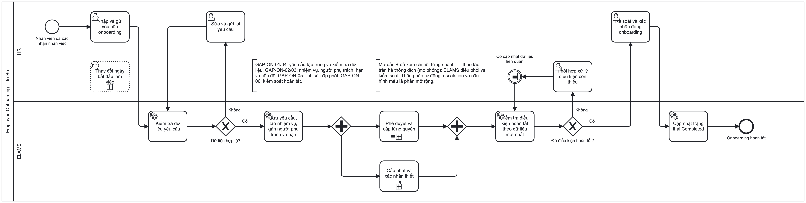
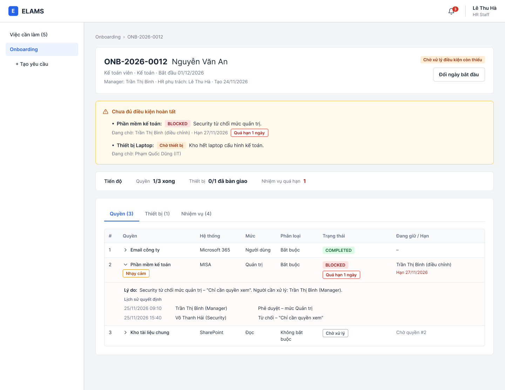

# ELAMS – Employee Lifecycle & Access Management System

Dự án phân tích nghiệp vụ cá nhân: thiết kế hệ thống quản lý **vòng đời nhân viên và quyền truy cập** cho TechNova, một công ty công nghệ giả định khoảng 500 nhân viên. Phạm vi gồm ba quy trình **Onboarding**, **Access Request** và **Offboarding**, đi từ khảo sát hiện trạng tới SRS, ERD, wireframe và kịch bản UAT.

**Đọc nhanh trong 5 phút:** [Case study một trang](case-study.md)

---

## Bài toán

TechNova tiếp nhận, cấp quyền và xử lý nghỉ việc bằng email, Excel và tin nhắn:

- HR không biết nhiệm vụ nào của nhân viên mới chưa xong, ai đang giữ.
- Quyền nhạy cảm có thể được cấp khi chưa qua Security; phê duyệt nằm rải rác trong email.
- Tài khoản của người đã nghỉ việc có thể vẫn hoạt động, nhất là khi nghỉ đột xuất.

## Giải pháp

Một hệ thống tập trung nơi mỗi việc đều có người phụ trách, hạn và trạng thái; mỗi quyền đi đúng cấp phê duyệt theo danh mục; và mọi quyền đã cấp được ghi vào một **sổ quyền** chung, để khi nhân viên nghỉ việc, hệ thống biết chính xác cần thu hồi những gì.

| Quy trình | Điểm chính |
| --- | --- |
| Onboarding | Tự tạo nhiệm vụ theo mẫu chức danh; từng quyền được duyệt và cấp lần lượt; quyền bắt buộc bị từ chối thì **chặn (BLOCKED)** chứ không kết thúc; chỉ đóng khi hệ thống kiểm tra đủ điều kiện và HR xác nhận |
| Access Request | Nhân viên tự gửi yêu cầu; cấp phê duyệt suy ra từ danh mục (quyền nhạy cảm cần Security sau Manager); không ai tự duyệt yêu cầu của mình |
| Offboarding | Danh sách thu hồi lập tự động từ sổ quyền; thu hồi lúc 18:00 ngày cuối hoặc trong 4 giờ nếu nghỉ đột xuất; thu hồi quyền **không có ngoại lệ**, thiết bị thì có ngoại lệ được Manager duyệt |

## Sản phẩm

| Giai đoạn | Tài liệu |
| --- | --- |
| Khởi tạo | [Project Charter](project-management/project-charter.md) · [Roadmap](project-management/roadmap.md) |
| Khảo sát | [Stakeholder Analysis](discovery/stakeholder-analysis.md) · [Thu thập yêu cầu](discovery/requirement-elicitation.md) · [Ghi chú phỏng vấn](discovery/interview-notes.md) · [Mục tiêu, KPI, phạm vi](discovery/business-goals-kpis-and-scope.md) · [Nhật ký câu hỏi mở](discovery/open-questions-log.md) |
| Phân tích quy trình | [Phân tích As-Is](process-models/as-is-process-analysis.md) · [Pain Point & Gap Analysis](process-models/pain-point-and-gap-analysis.md) · [BPMN As-Is](process-models/as-is/) · [BPMN To-Be](process-models/to-be/) |
| Yêu cầu nghiệp vụ | [Business Rules Catalog](requirements/business-rules/business-rules-catalog.md) · BRD: [Onboarding](requirements/brd/brd-onboarding.md), [Access Request](requirements/brd/brd-access-request.md), [Offboarding](requirements/brd/brd-offboarding.md) |
| Use case, user story | Use case: [Onboarding](requirements/use-case-specifications/onboarding-use-cases.md), [Access Request](requirements/use-case-specifications/access-request-use-cases.md), [Offboarding](requirements/use-case-specifications/offboarding-use-cases.md) · User story và AC: [Onboarding](requirements/user-stories/onboarding-user-stories.md), [Access Request](requirements/user-stories/access-request-user-stories.md), [Offboarding](requirements/user-stories/offboarding-user-stories.md) |
| Hệ thống | [SRS](requirements/srs/srs-elams.md) · [ERD và từ điển dữ liệu](data-models/) |
| Giao diện | Đặc tả màn hình: [Onboarding](ui-ux/onboarding-screen-specifications.md), [Access Request](ui-ux/access-request-screen-specifications.md), [Offboarding](ui-ux/offboarding-screen-specifications.md) · [Wireframe Figma](https://www.figma.com/design/sxQaybHEwuvCMIBTmxwuxE/ELAMS) |
| Kiểm chứng | RTM: [Onboarding](traceability/rtm-onboarding.md), [Access Request](traceability/rtm-access-request.md), [Offboarding](traceability/rtm-offboarding.md) · UAT: [Onboarding](validation/uat-onboarding.md), [Access Request](validation/uat-access-request.md), [Offboarding](validation/uat-offboarding.md) |

**Quy mô:** 6 sơ đồ BPMN · 30 quy tắc nghiệp vụ · 33 yêu cầu nghiệp vụ · 27 use case · 38 user story với 144 acceptance criteria · 13 màn hình · 58 yêu cầu chức năng và 13 phi chức năng · 23 bảng dữ liệu · 40 test case UAT.

Mỗi yêu cầu nghiệp vụ được truy vết tới quy tắc, bước BPMN, use case, user story, màn hình, yêu cầu SRS và test case UAT.

## Giới hạn

- TechNova, stakeholder và dữ liệu là giả định; phỏng vấn được giả lập.
- Tài liệu chưa được stakeholder thật xác nhận. Các điểm chưa chắc chắn được ghi thành giả định có mã tại [Nhật ký câu hỏi mở](discovery/open-questions-log.md), không được trình bày như sự thật.
- Chưa có phần mềm chạy được; thư mục [implementation](implementation/) dành cho giai đoạn lập trình tùy chọn.

## Công cụ

Camunda Modeler (BPMN 2.0) · draw.io (use case, ERD) · Figma (wireframe) · Markdown, Mermaid · Git, GitHub

## Cấu trúc thư mục

| Thư mục | Nội dung |
| --- | --- |
| [project-management](project-management/) | Charter, roadmap |
| [discovery](discovery/) | Stakeholder, thu thập yêu cầu, KPI, câu hỏi mở |
| [requirements](requirements/) | Business rules, BRD, use case, user story, SRS, quyết định thiết kế |
| [process-models](process-models/) | Phân tích As-Is, gap, BPMN As-Is và To-Be |
| [data-models](data-models/) | ERD, từ điển dữ liệu |
| [ui-ux](ui-ux/) | Đặc tả màn hình, wireframe |
| [validation](validation/) | Kịch bản UAT, review log |
| [traceability](traceability/) | Ma trận truy vết |
| [implementation](implementation/) | Ghi chú kỹ thuật, dành cho lập trình |

---

## English summary

ELAMS is a personal Business Analysis project for a fictional 500-employee company. It covers three processes (employee onboarding, access requests and offboarding) from discovery to delivery-ready specifications: As-Is/To-Be BPMN, a business rules catalog, BRDs, use cases, user stories with Given/When/Then acceptance criteria, screen specifications with Figma wireframes, a logical ERD with data dictionary, an SRS, traceability matrices and UAT scripts. Documents are written in Vietnamese with standard English BA terminology.
